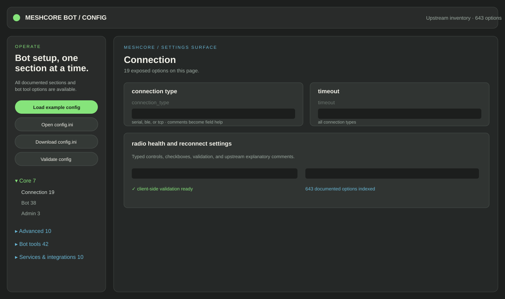

# MeshCore Bot Config Editor

<div align="center">



**A calm, browser-first control surface for editing MeshCore Bot configuration.**

[View the repository](https://github.com/eastmesh/meshcore-config-editor) · [View the upstream bot](https://github.com/agessaman/meshcore-bot)

</div>

> **Status:** browser-only editor / LAN preview. It reads local files in the browser and downloads an edited `config.ini`; it does not write to a running bot, expose a backend API, or restart services.

## Why this exists

MeshCore Bot exposes a broad configuration surface. This editor turns that surface into navigable, section-sized pages so operators can find the setting they need without losing the safety of a local file workflow.

## Features

- **77 configuration sections and 643 documented options** from the upstream `config.ini.example` inventory.
- **Grouped navigation** for Core, Bot tools, Services & integrations, Content & automation, and Advanced settings.
- **One page per section** with option counts and filterable navigation.
- **Typed controls**: checkboxes for boolean settings and text fields for open values.
- **Dynamic settings preserved** so unknown or open-ended keys are not silently discarded.
- **Connection-aware editing** for `serial`, `ble`, and `tcp` modes.
- **Upstream comment help** rendered as field guidance and hover tooltips.
- **Client-side preflight validation** for common type and connection errors.
- **Credential-conscious workflow**: local import, local editing, browser download.

## Screenshots

The preview above shows the grouped navigation, section-based layout, typed fields, inline help, and dark EastMesh visual language. The UI is intentionally dense enough for operations work while keeping the configuration surface discoverable.

## Quick start

The simplest option is to open `index.html` directly in a browser. For LAN access, serve this directory with a static HTTP server:

```bash
python3 -m http.server 8790 --bind 0.0.0.0
```

Then open:

```text
http://HOST-LAN-IP:8790/
```

The editor loads `meshcore-config-schema.json` relative to the page, so use an HTTP server when running the published layout. Replace `HOST-LAN-IP` with the actual address of the machine hosting it; do not copy the example address into a different network.

## Using the editor

1. Open the editor.
2. Choose **Open config.ini** and select a working copy.
3. Select a navigation group and then a section.
4. Edit the fields on that page.
5. Use the inline comments and hover tooltips as guidance.
6. For dynamic sections, edit existing rows or use **+ Add key**.
7. Choose **Validate config** to run client-side checks.
8. Fix any reported type or connection errors.
9. Choose **Download config.ini** only after validation passes.
10. Validate the downloaded file with MeshCore Bot's own validation workflow before deploying it.

The included schema is an inventory generated from the upstream example configuration. It is intentionally separate from the bot runtime: updating the upstream bot does not automatically update this static editor. Regenerate or review the schema whenever the upstream configuration changes.

## Schema and coverage

`meshcore-config-schema.json` contains:

- `sections`: section names in upstream example-file order.
- `meta`: documented keys, inferred control hints, and imported comment help.

The editor preserves keys that are not in the inventory as dynamic values when it loads a configuration. This is a compatibility aid, not proof that an unknown key is accepted by the bot. The upstream bot remains the authority for validation and runtime behavior.

## Safety notes

- Do not upload real credentials, tokens, private keys, or production configurations to a public repository.
- The public repository contains the editor, schema, and a UI preview only; no live configuration is included.
- The browser editor does not persist files remotely. Downloaded output is saved by the browser.
- LAN HTTP is unencrypted. Use it only on a trusted network, or place the editor behind an authenticated HTTPS reverse proxy before wider exposure.
- Review configuration diffs and create a backup before applying changes to a bot deployment.

## Updating from upstream

1. Review the upstream `config.ini.example` and schema/validation changes.
2. Regenerate or update `meshcore-config-schema.json`.
3. Test the editor with representative configs, including dynamic sections and secrets represented only by placeholders.
4. Run the local static server and verify import, navigation, editing, and export.
5. Commit the updated editor, schema, and documentation together.

## Repository layout

```text
index.html                    # self-contained browser UI
meshcore-config-schema.json   # upstream option inventory, hints, and help text
docs/editor-preview.svg       # README UI preview
README.md                     # usage, safety, and maintenance notes
LICENSE                       # MIT license for this editor repository
```

## Relationship to MeshCore Bot

This project is an independent UI companion for MeshCore Bot. It does not modify, vendor, or redistribute the upstream bot runtime. MeshCore Bot's own license and documentation apply to the bot project itself.
